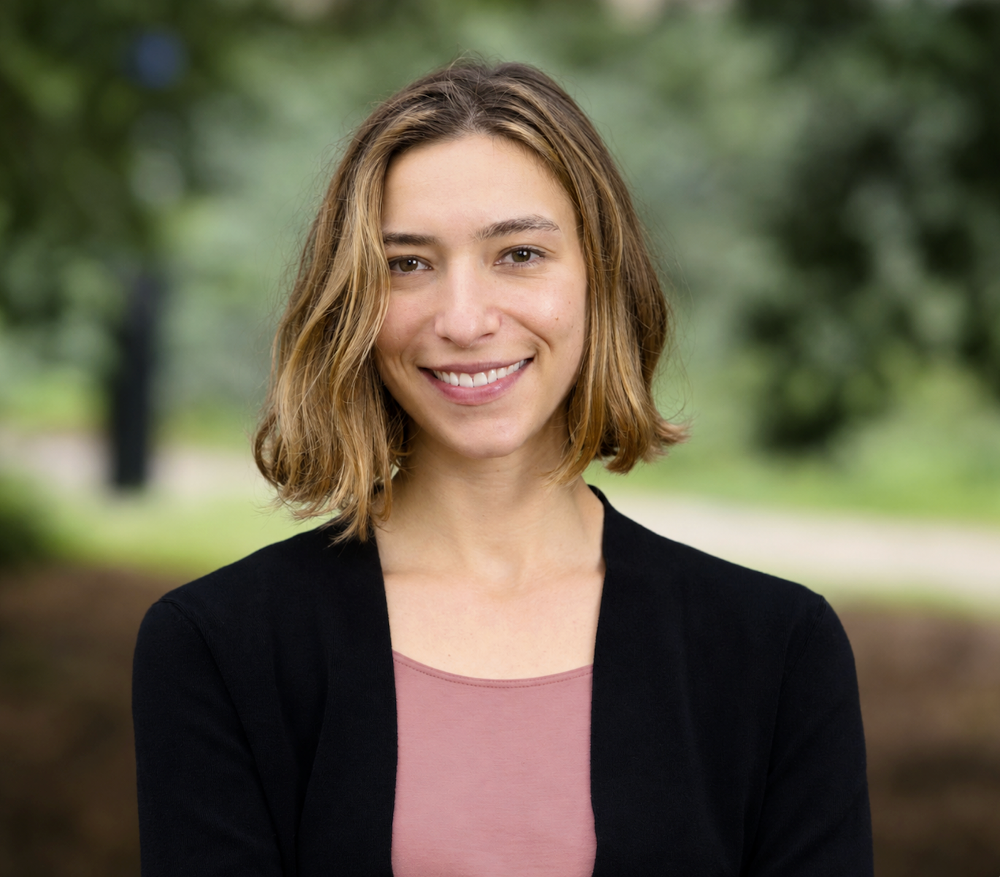

# Welcome!

<figure class="headshot">
  
  <figcaption>Photo by Mathew E Burciaga</figcaption>
</figure>

I am a Earth systems scientist working at the nexus of water, carbon, and people. My work focuses on the biophysical effects of drought at ecosystem to global scales using machine learning and remote sensing data. I studied how [groundwater drought](https://doi.org/10.1016/j.agrformet.2023.109725) affects carbon sequestration, the effectiveness of [cutting-edge hyperspectral instruments](https://doi.org/10.1029/2023GL107429) in estimating plant water stress, and the benefits of [sustainable management strategies](https://doi.org/10.1088/1748-9326/ae15a9) on agricultural water-use efficiency. My postdoctoral training at the Carnegie Institution at Stanford (Biosphere Sciences & Engineering Division) focused on land-surface modeling and water scarcity in Latin America. With a background in journalism and oral history, my research emerges from societal need and responds to stakeholder priorities.

I worked as a newspaper staff reporter and have written about seal population booms, tenant farmers and illicit mushroom foragers. My work has appeared in the [_Provincetown Independent_](https://provincetownindependent.org/author/s-ruehr/), [_InsideClimate News_](https://insideclimatenews.org/news/01102019/hurricane-warm-water-climate-change-history-science-study-sediment-core-donnelly-muller/) and the [_Provincetown Banner_](https://www.wickedlocal.com/story/provincetown-banner/2018/09/06/number-one-issue-at-ponds/10834043007/). In Vanuatu, I collected [oral histories](https://islandstudiesjournal.org/article/84747-beyond-the-vulnerability-resilience-dichotomy-perceptions-of-and-responses-to-the-climate-crisis-on-emau-vanuatu) about climate change. 

I graduated from Yale University with a B.S. in Geology & Geophysics and received my Ph.D. from UC Berkeley’s Department of Environmental Science, Policy and Management. I write songs for jazz guitar and regularly perform in the East Bay with [my band](https://www.instagram.com/soph.n.gabe/). 
